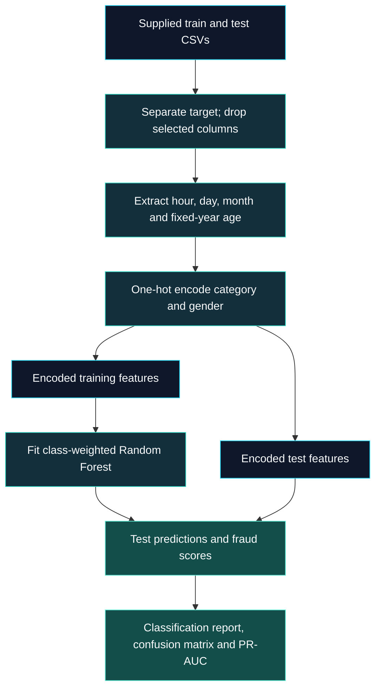

<p align="center"><strong>FRAUD INTELLIGENCE</strong><br/><sub>Machine Learning for Transaction Risk Detection</sub></p>

<h1 align="center">CREDIT CARD FRAUD DETECTION</h1>

<p align="center">A class-weighted Random Forest study of rare-event detection at transaction scale.</p>

<p align="center">
  
  
  
  
  
  <a href="LICENSE"></a>
</p>

Fraud detection requires finding a small minority of suspicious transactions without overwhelming legitimate customers with false alerts. This project applies timestamp features, one-hot encoding, and a class-weighted Random Forest to **1,852,394 simulated transactions** across the supplied training and test files. On the **555,719-transaction test set**, saved evaluation artifacts report **87.83% fraud recall**, **57.00% fraud precision**, and **0.8610 PR-AUC**.

| Dataset scale | Fraud recall | Fraud precision | PR-AUC |
|:---:|:---:|:---:|:---:|
| **1,852,394** | **88%** | **57%** | **0.86** |
| Train + test transactions | 1,884 / 2,145 frauds found | 1,884 / 3,305 alerts correct | Across score thresholds |

<p align="center"><sub>Headline values are rounded. Results are supported by saved notebook outputs and charts; training was not rerun for this documentation update.</sub></p>

**Quick navigation**

| Understand | Inspect | Reproduce & extend |
|---|---|---|
| [01 Overview](#01-executive-overview) | [04 Architecture](#04-system-architecture) | [10 Repository](#10-repository-structure) |
| [02 Business problem](#02-the-business-problem) | [05 Preprocessing](#05-feature-engineering--preprocessing) | [11 Getting started](#11-getting-started) |
| [03 Dataset](#03-dataset-intelligence) | [06 Model](#06-machine-learning-model) | [12 Trade-offs](#12-technical-decisions--trade-offs) |
| [07 Results](#07-results--model-evaluation) | [08 Visual analysis](#08-visual-analysis) | [14 Roadmap](#14-future-roadmap) |
| [13 Limitations](#13-limitations) | [09 Reliability](#09-data-leakage--reliability) | [15 Author](#15-author--license) |

---

## 01 Executive overview

This repository implements an **offline binary classification experiment**: load labeled transactions, construct features, train a Random Forest, and evaluate fraud predictions and probability scores on a separate supplied test file. The [notebook](credit_card_fraud_detection.ipynb) contains exploration and saved results; the [Python script](credit_card_fraud_detection.py) expresses the same modeling workflow as a sequential program.

The central result is an observable detection trade-off: **1,884 frauds detected alongside 1,421 false alerts**. The project demonstrates minority-class evaluation and training-only encoder fitting. Deployment, automated transaction review, and a reusable inference service are outside the implemented scope.

## 02 The business problem

Only **0.3860% of test transactions are fraudulent**, approximately one in 259. A classifier that always predicts legitimate would achieve **99.6140% accuracy and zero fraud recall**. This is an arithmetic reference derived from the test labels, not a separately trained baseline.

| Error | Consequence to investigate |
|---|---|
| **False negative:** fraud predicted legitimate | A fraudulent transaction escapes detection. |
| **False positive:** legitimate predicted fraud | A legitimate transaction may require review or customer verification. |

Neither consequence has a measured monetary cost in this repository. Recall measures how much fraud is found; precision measures how reliable the alerts are. Both matter when assessing investigation capacity and customer friction, so overall accuracy alone is insufficient.

## 03 Dataset intelligence

**Source:** [Credit Card Transactions Fraud Detection Dataset](https://www.kaggle.com/datasets/kartik2112/fraud-detection), published by **Kartik Shenoy (`kartik2112`)**. The publisher describes simulated transactions generated with [Brandon Harris's Sparkov Data Generation tool](https://github.com/namebrandon/Sparkov_Data_Generation), with an earlier training period and a later test period in 2019–2020. See the [publisher's dataset discussion](https://www.kaggle.com/kartik2112/discussion) for provenance and split context. These are synthetic records; measured performance does not establish performance on real payment traffic.

| Supplied file | Transactions | Legitimate (`0`) | Fraud (`1`) | Fraud share |
|---|---:|---:|---:|---:|
| `fraudTrain.csv` | 1,296,675 | 1,289,169 | 7,506 | 0.5789% |
| `fraudTest.csv` | 555,719 | 553,574 | 2,145 | 0.3860% |
| **Total** | **1,852,394** | **1,842,743** | **9,651** | **0.5210%** |

**Evidence:** training size comes from the notebook's saved `train_df.info()` output. Training class counts are derived from its binary target mean (`0.005788652`) and row count; the displayed mean's rounding interval admits only 7,506 positive labels. Test size and class counts come from the saved classification report and confusion matrix. The CSVs are not present in this checkout, so these counts were not independently recounted from raw data.

The target is **`is_fraud`**, where `0` means legitimate and `1` means fraud. The saved training schema contains **23 columns**, including the target and an exported row index. Inputs cover transaction amount and time, merchant category, cardholder demographics, location coordinates, and city population; identifiers and several descriptive fields are removed before modeling.

The code reads the two files directly, preserving their supplied split without shuffling or creating a new split. The difference in fraud prevalence between the files also matters when interpreting precision. Download and placement instructions are in [Getting started](#11-getting-started); data is not tracked, and [`.gitignore`](.gitignore) excludes CSV files. Consult the dataset page for its data-use terms; the repository's MIT license applies to its code.

## 04 System architecture



The encoder is **fitted on training features only**, then reused to transform test features. Target values are excluded from the feature matrix and used for training or evaluation as appropriate. These steps are implemented sequentially, rather than packaged in a scikit-learn `Pipeline`.

## 05 Feature engineering & preprocessing

Both implementations perform the following transformations:

| Step | Actual implementation | Interpretation & constraint |
|---|---|---|
| Separate the label | Extract `is_fraud` into `ytrain_df` / `ytest_df`; drop it from features. | Keeps the target out of model inputs. |
| Remove IDs and descriptive fields | Drop `Unnamed: 0`, `trans_num`, `cc_num`, `first`, `last`, `street`, `unix_time`, `merchant`, `job`, `city`, `state`, `zip`. | Removes identifiers and several categorical/location fields. No ablation study establishes the effect of each removal. |
| Transaction time | Parse `trans_date_trans_time`; extract `hour`, `day`, `month`; drop the raw timestamp. | `day` is **day of month**, not day of week. No cyclic encoding or transaction-history features are implemented. |
| Age feature | Parse `dob`; compute **`2026 - birth_year`**; drop `dob`. | A fixed-reference-year feature, **not age at transaction time**; it ignores birthday and transaction year. |
| Categorical encoding | `OneHotEncoder(sparse_output=False, handle_unknown='ignore')` on `category` and `gender`. | Dense output; unseen values yield zeros for that feature's encoded columns. |
| Numeric passthrough | `ColumnTransformer(remainder='passthrough')`. | Retains `amt`, `lat`, `long`, `city_pop`, `merch_lat`, `merch_long`, and the four engineered features without scaling. |
| Missing-value inspection | Run `train_df.info()` and `train_df.isnull().sum()`. | Saved training outputs show no missing values. **No imputation, missing-row removal, or explicit test-set missingness check is implemented.** |

The column removals are verifiable decisions; reducing identity dependence and categorical expansion is a reasonable engineering interpretation, not a measured finding. Dropped fields such as merchant, occupation, and location may contain useful signal. Their removal does not prove that memorization or leakage has been eliminated.

## 06 Machine learning model

The script and notebook specify the same estimator and explicit parameters:

```python
RandomForestClassifier(
    n_estimators=150,
    max_depth=20,
    min_samples_split=5,
    min_samples_leaf=2,
    max_features='sqrt',
    class_weight='balanced',
    random_state=42,
    n_jobs=-1
)
```

A Random Forest can model nonlinear interactions between amounts, temporal features, and encoded categories without requiring feature scaling. The configured depth and leaf constraints limit tree growth, while `n_jobs=-1` uses all available processors. No model comparison or hyperparameter search is recorded.

**Class weighting:** scikit-learn's `balanced` mode assigns training weights inversely proportional to class frequency: `n_samples / (n_classes * class_count)`. This increases the rare class's contribution to fitting; it does not resample the input dataset or encode measured financial costs. See the [estimator documentation](https://scikit-learn.org/stable/modules/generated/sklearn.ensemble.RandomForestClassifier.html).

**Decision rule:** hard labels come from `classifier.predict(Xtest_df)`, which selects the class with the highest mean probability across trees. For these binary labels this corresponds to fraud probability **greater than 0.5**; an exact tie selects class `0`. PR analysis uses `predict_proba(Xtest_df)[:, 1]`. **No explicit decision-threshold optimization or probability calibration is implemented.**

## 07 Results & model evaluation

The evaluation uses all **555,719 rows of the supplied test file**, including **2,145 frauds**. The table below reconciles the saved notebook report with the counts visible in both the notebook's embedded confusion matrix and the repository image.

| Metric | Verified value | Evidence / calculation |
|---|---:|---|
| **Fraud recall** | **87.83%** | `1,884 / 2,145`; notebook report rounds to `0.88`. |
| **Fraud precision** | **57.00%** | `1,884 / 3,305`; notebook report rounds to `0.57`. |
| Fraud F1 | 0.6914 | `2 × TP / (2 × TP + FP + FN)`; report rounds to `0.69`. |
| **PR-AUC** | **0.8610** | Saved notebook printout; both curve titles round to `0.86`. |
| Accuracy | 99.6973% | Saved `accuracy_score`: `0.9969732904579472`; also matches the matrix. |
| False-positive rate | 0.2567% | `1,421 / 553,574` legitimate transactions. |

The extra decimal places for recall, precision, F1, and false-positive rate are **derived from saved matrix counts**, not additional experiment outputs. PR-AUC is computed by `precision_recall_curve` followed by `auc(recall_vals, precision_vals)`: **trapezoidal area under the PR curve**, not `average_precision_score`.

### Confusion matrix counts

Rows are actual labels; columns are predicted labels.

| Actual / predicted | Legitimate (`0`) | Fraud (`1`) | Total |
|---|---:|---:|---:|
| **Legitimate (`0`)** | **TN: 552,153** | **FP: 1,421** | 553,574 |
| **Fraud (`1`)** | **FN: 261** | **TP: 1,884** | 2,145 |
| **Total** | **552,414** | **3,305** | **555,719** |

The model identifies **1,884 of 2,145 frauds**, leaving **261 undetected**. Of **3,305 alerts**, **1,421 (43.00%)** are legitimate transactions. That combination illustrates why a low false-positive rate can still produce a substantial false-alert workload when fraud is rare. It is an observed operating point, not evidence of a deliberately optimized review policy or quantified savings.

### Evidence and reproducibility boundary

The [notebook](credit_card_fraud_detection.ipynb) stores the classification report and accuracy in its **Accuracy & Classification Report** cell, the matrix under **Confusion Matrix**, and `PR-AUC Score: 0.8610` under **Precision-Recall Curve**. The [script](credit_card_fraud_detection.py) contains the matching evaluation logic but no stored run results.

The notebook's execution counters are nonsequential, and its encoding cell has no execution count despite later fitted-model outputs. Consequently, the saved artifacts substantiate the reported results but do **not** demonstrate a clean, top-to-bottom run of the current notebook. Dependencies are unpinned, and neither raw predictions nor a fitted model are stored. Exact reproduction remains to be confirmed in a fresh run with the downloaded data.

## 08 Visual analysis

### Confusion matrix


*The repository's saved chart confirms the error counts above. The large legitimate class dominates the color scale, so read the fraud-row annotations alongside the precision and recall metrics.*

### Precision–recall curve


*The curve shows how fraud precision and recall vary across score thresholds. Precision falls as recall approaches one. The title rounds the notebook's 0.8610 area to 0.86; no business operating threshold is selected by this plot.*

Both are existing evaluation images, and their values agree with the notebook's embedded plots. They are displayed as stored; the purple chart styling is preserved.

## 09 Data leakage & reliability

| Demonstrated safeguard | What it establishes |
|---|---|
| Separate supplied CSVs | The code fits the estimator on training rows and evaluates on test rows. |
| Target removed before transformation | `is_fraud` is not included among predictors. |
| `ct.fit_transform(Xtrain_df)` followed by `ct.transform(Xtest_df)` | Encoder categories are learned only from training features. |
| Identical deterministic date transformations | Test-set statistics are not used to construct the timestamp and fixed-year age features. |

These safeguards address specific leakage routes. They do not establish complete independence: the code does not audit duplicate records, cardholder overlap, timestamp boundaries, or entity overlap between files. Removing a card number does not remove every customer-specific signal; demographics and coordinates remain.

There is one fixed held-out evaluation, with no validation split, cross-validation, confidence intervals, or repeated time-window tests. The repository also does not document how the configuration was selected, so the saved artifacts cannot establish whether earlier decisions were influenced by test performance. A later test period from the same simulator does not establish robustness to new fraud strategies or real-world distribution shifts.

## 10 Repository structure

The tracked project files are:

```text
Credit-Card-Fraud-Detection/
|-- images/
|   |-- Confusion M.png
|   `-- Precision-Recall Curve.png
|-- .gitignore
|-- credit_card_fraud_detection.ipynb
|-- credit_card_fraud_detection.py
|-- LICENSE
|-- README.md
`-- requirements.txt
```

The notebook and script are at the **repository root**. There are no tracked `data/`, `notebooks/`, `src/`, or `models/` directories. Running the project requires two downloaded CSVs at the root; the setup below also creates an ignored local `venv/` directory.

## 11 Getting started

### Prerequisites

Use a **Python 3.11 environment** as a starting point: the notebook records Python **3.11.9**. The code requires **scikit-learn 1.2 or later** for the [`sparse_output` encoder argument](https://scikit-learn.org/stable/modules/generated/sklearn.preprocessing.OneHotEncoder.html). This is API compatibility guidance, not a tested version matrix. [Requirements](requirements.txt) list pandas, NumPy, scikit-learn, Matplotlib, seaborn, and Jupyter without pinned versions; the original complete environment is not captured.

The full run loads both CSVs into memory, creates dense encoded arrays and DataFrames, and fits 150 trees. Allow substantial memory and training time; no hardware, runtime, or peak-memory benchmark is recorded.

### Clone and create an environment

```bash
git clone https://github.com/khaled-amireh/Credit-Card-Fraud-Detection.git
cd Credit-Card-Fraud-Detection
```

**Windows — PowerShell**

```powershell
py -3.11 -m venv venv
.\venv\Scripts\Activate.ps1
```

If PowerShell blocks activation, use the environment's interpreter directly in subsequent Python commands: `.\venv\Scripts\python.exe`. This avoids changing execution policy.

**macOS / Linux — bash or zsh**

```bash
python3.11 -m venv venv
source venv/bin/activate
```

With the environment active, install dependencies:

```bash
python -m pip install -r requirements.txt
```

### Download the dataset

1. Open the [Kaggle dataset page](https://www.kaggle.com/datasets/kartik2112/fraud-detection) and download the dataset archive. Sign in if prompted.
2. Extract **`fraudTrain.csv`** and **`fraudTest.csv`**.
3. Place both files **beside the script and notebook**, not inside a `data/` folder:

```text
Credit-Card-Fraud-Detection/
|-- fraudTrain.csv                    # downloaded locally; ignored by Git
|-- fraudTest.csv                     # downloaded locally; ignored by Git
|-- credit_card_fraud_detection.py
`-- credit_card_fraud_detection.ipynb
```

Both entry points call `pd.read_csv('fraudTrain.csv')` and `pd.read_csv('fraudTest.csv')`. Keep the current working directory at the repository root.

### Run either entry point

**Notebook**

```bash
python -m notebook credit_card_fraud_detection.ipynb
```

Choose the environment's Python kernel, restart it, and run all cells in order. A fresh run is necessary to evaluate reproducibility given the saved execution history. Exploration tables display in the notebook.

**Python script**

```bash
python credit_card_fraud_detection.py
```

The script fits the model, prints training schema information, accuracy, the classification report, and PR-AUC, and opens Matplotlib figures. Its standalone `describe()` and missing-count expressions do not print tables as notebook cells do. Use an interactive plotting environment; `plt.show()` may block until a figure is closed. Neither entry point exports the fitted model, predictions, or chart files automatically, so running it does not update the tracked images.

## 12 Technical decisions & trade-offs

These interpretations explain the current design; they are not conclusions from controlled comparisons.

| Implemented choice | Engineering rationale | Trade-off |
|---|---|---|
| Random Forest with growth constraints | Models nonlinear tabular interactions with no scaling step. | Fit cost and model size are unmeasured; superiority over other estimators is untested. |
| Balanced class weights | Raises the minority class's contribution without explicit over/undersampling. | Does not select an alert threshold or optimize a financial cost function. |
| One-hot encoding of two categorical fields | Avoids imposing an ordinal relationship on categories. | Dense representation consumes memory; unseen categories lose category-specific information. |
| Remove IDs and several descriptive fields | Limits direct identifier use and potential categorical expansion. | Useful merchant, occupation, and geographic signal may be discarded. |
| Emphasize fraud metrics and PR analysis | Makes missed fraud and false alerts visible under severe imbalance. | An aggregate curve does not determine review capacity, calibration, or deployment suitability. |

## 13 Limitations

- **Evidence is from saved artifacts.** Incomplete execution history, absent raw data in this checkout, and unpinned dependencies limit exact reproducibility claims.
- **One simulator and one supplied split.** Entity independence, temporal boundaries, and robustness across periods or real payment populations have not been audited.
- **False alerts remain substantial.** About 43% of alerts are false positives at the current prediction rule; actual investigation costs are unknown.
- **Feature and decision policies are fixed.** Age uses the hard-coded year 2026; there is no threshold search, calibration, cost-sensitive evaluation, or feature ablation.
- **Operational capabilities are absent.** No persisted preprocessing/model bundle, inference interface, schema validation, serving, monitoring, drift detection, or automated retraining is implemented. Missing-data remediation and subgroup performance analysis are also absent.

## 14 Future roadmap

All items below are **not implemented**.

- [ ] Reproduce a clean notebook/script run; capture dependency versions, data checksums, and evaluation artifacts.
- [ ] Audit duplicates, shared cardholders, and time boundaries; add time-aware and entity-aware validation where appropriate.
- [ ] Compare configurations with cross-validation or repeated temporal holdouts, reserving a final untouched test set.
- [ ] Optimize the decision threshold on validation data against review capacity and explicit false-positive/false-negative costs.
- [ ] Assess probability calibration and report cost-sensitive metrics, uncertainty, and subgroup performance.
- [ ] Benchmark gradient boosting alternatives, including XGBoost or LightGBM, under the same evaluation protocol.
- [ ] Evaluate transaction-time age, cardholder–merchant distance, and past-only transaction-frequency features with ablation studies.
- [ ] Add SHAP explanations and investigate common error patterns.
- [ ] Persist preprocessing and the estimator together; build a reproducible inference workflow with input validation and tests.

## 15 Author & license

**Khaled Amireh** · [GitHub](https://github.com/khaled-amireh) · [Portfolio](https://portfolio-1kpn.onrender.com)

Code is released under the [MIT License](LICENSE), copyright © 2026 Khaled Amireh. Dataset attribution and access remain with the [Kaggle source](https://www.kaggle.com/datasets/kartik2112/fraud-detection) and its credited generator.